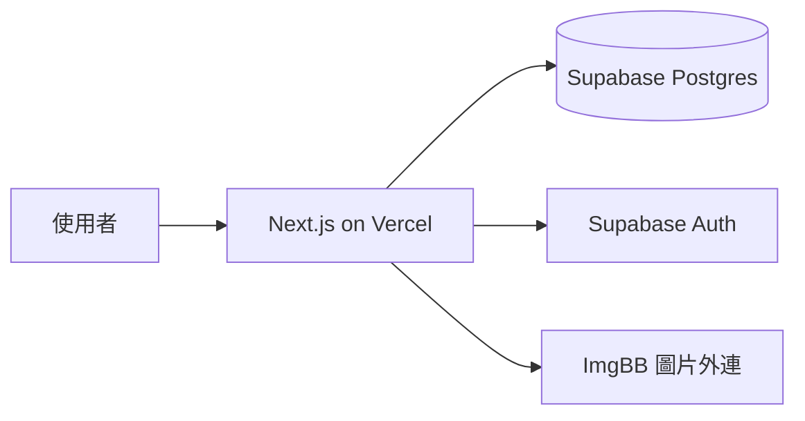

<h1 align="center">GreenThumb</h1>

<p align="center">討論各種植物種植技巧的論壇</p>

<p align="center">
  
  
  
</p>

<!-- 封面：docs/images/cover.png，放論壇首頁截圖 -->

## ✨ 規劃特色

- 🌱 依植物物種分類討論，點進物種頁就能看到所有相關文章
- 📷 發文、回覆都能附上照片，方便分享植株狀況
- 🗂️ 結構化照護卡：光照、澆水、介質、適溫一目了然
- 🗺️ 依台灣地區與氣候篩選種植經驗
- ✅ 發問文可以選出最佳解答，好答案不會被埋沒
- 📔 用種植日誌記錄同一株植物的成長過程



## 🚀 快速開始

使用 Node.js 24 安裝依賴並啟動開發伺服器。

```sh
npm ci
npm run dev
```

在 `.env.local` 設定 Supabase Project URL 與公開金鑰後，在瀏覽器開啟 `http://localhost:3000`。會員、登入、討論文章及在地專欄均使用 Supabase；本機 SQLite 保留為切換前備份。建表、驗證信、管理員及部署步驟見 [Supabase 設定](docs/supabase-setup.md)。

專欄頁 `/columns` 提供台灣達人地圖。點「發表在地專欄」，選擇縣市與鄉鎮市區後發表，地圖會顯示區域圖釘；沒有文章時顯示空狀態。首頁精選、專欄、討論、會員草稿與收藏都從 Supabase 讀寫，不混入示範文章或本機內容。以 `npm run test:supabase` 執行資料與權限測試，實作及資料來源見 [台灣達人地圖](docs/taiwan-expert-map.md)。

## 📁 專案結構

```
GreenThumb/
├── README.md
├── CLAUDE.md
├── LICENSE     # 授權條款
├── .gitignore  # 版控忽略規則
├── src/        # 程式碼本體
├── tests/      # 測試
├── docs/       # 設計文件、API 說明
├── scripts/    # 開發輔助腳本（build / release / 資料處理）
├── examples/   # 可執行的使用範例
└── .github/
```

## 🗺️ Roadmap

**目前階段**為網頁原型，會員、所有文章、編輯精選、會員草稿及收藏均使用 Supabase；網站只保留版型、操作文字與基本分類／行政區選項。登入後手動儲存的草稿與收藏可跨裝置讀取。

- [x] MVP 資料表設計（[`docs/database-schema.md`](docs/database-schema.md)）
- [ ] **MVP**：會員、發文（發問／分享／教學）、回覆、圖片上傳、物種與自由標籤、地區、按讚、最佳解答
- [ ] **第二階段**：照護卡、全文搜尋
- [ ] **第三階段**：種植日誌、AI 植物辨識／病蟲害判斷

## 📄 License

本專案採用 MIT 授權，全文見 [`LICENSE`](LICENSE)。

---

<sub>給 AI agent 的專案指示在 [`CLAUDE.md`](CLAUDE.md)。</sub>
