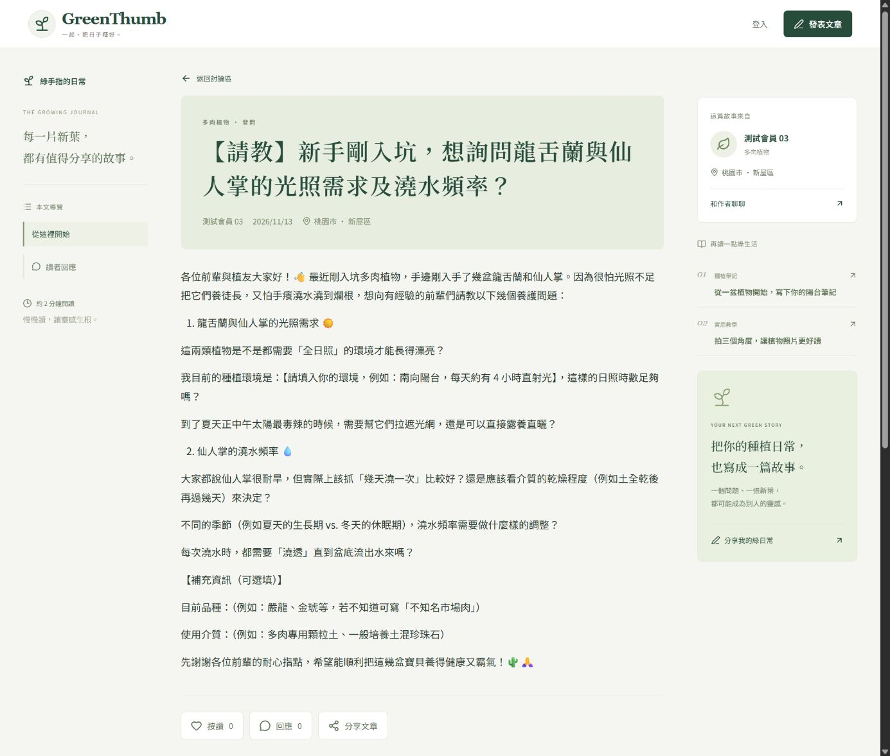
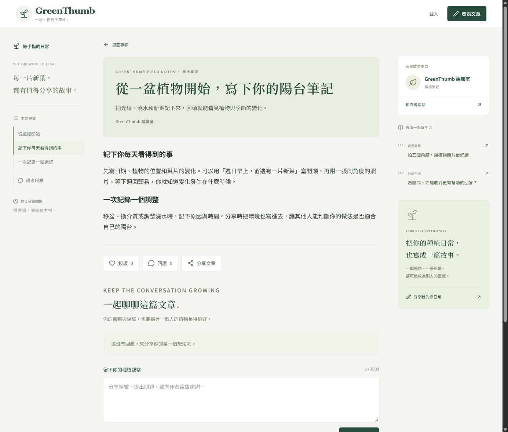

# 文章讀取防護與桌面閱讀版型驗收

- 日期：2026-11-15，Asia/Taipei；JSON 時間使用 UTC。
- 唯一應用驗收目標：[Vercel 正式站](https://greenthumb-eta.vercel.app/)，沒有啟動 self-host。
- 功能程式已推送 GitHub `main`，最終功能版本為 `01a9726`；Vercel 已完成部署。
- 結果：27 項本機隔離回歸通過、15 項瀏覽器檢查通過。正式站 53 項回歸第一輪為 52 通過／1 公開頁容量失敗；修復後 13 項公開內容複驗通過，原失敗紀錄保留，沒有覆寫成單次 53/53。

## 已完成的行為

| 範圍 | 行為與驗證 |
| --- | --- |
| 討論網址 | 改為隨機 UUID v4；兩篇既有討論自動取得新網址，舊數字網址與 API 不再提供文章，也不轉址揭露 UUID |
| 文章資料 | 內部主鍵、作者與外鍵不變；首頁、地圖、編輯、收藏、回覆、按讚與分頁均使用公開 UUID |
| 列表 | 只回傳最多 50 篇、每篇前 180 個 Unicode 字元的摘要，無完整內文或內部流水號；作者編輯頁另載入完整內容與格式 |
| 讀取限流 | HTML／RSC 與公開 API 共用 PostgreSQL 計數：每來源每分鐘 90 次，其中列表最多 30 次；超量回應 429 與 Retry-After |
| 來源與索引 | 使用平台來源標頭及 HMAC，不以會員 cookie 或 User-Agent 區分額度；robots 排除 API／編輯／登入頁，公開文章仍允許索引 |
| 桌面閱讀 | 1200px 以上的討論、會員專欄與精選文章共用三欄；左側本文目錄與閱讀時間，右側作者／所在地、真實延伸閱讀與撰寫入口 |
| 目錄 | 每篇文章使用獨立 DOM 範圍及錨點；切換、返回快取頁面仍只列當前文章段落，內文變更時重建目錄 |
| 手機與窄畫面 | 隱藏兩側欄並保留原單欄；390×844 沒有水平溢出，1199／1200px 斷點正常。既有討論的新舊手機全頁截圖檔案完全相同 |

## 驗證證據

- [27 項隔離回歸原始輸出](local-tests.txt)：會員整合 7、session 9、輸入 5、讀取防護 3、連線池 3；ESLint、TypeScript 與 Next.js 正式建置通過，22/22 預渲染完成。
- [Vercel 53 項 API 原始回歸](regression/api-results.json)：三組一般會員的發表、作者修訂、草稿／收藏隔離、三種文章互動、舊會員 409、位置、輸入、分頁及登出。
- [公開頁與容量修正後複驗](recheck.json)：8 個公開頁、3 個不存在內容、兩會員的 UUID 討論／專欄閱讀與 API、摘要清單，13 項均通過。
- [UUID、數字網址、摘要、地圖與 robots 檢查](smoke.json)。
- [15 項瀏覽器檢查](ui-results.json)：包括三種閱讀頁、手機、斷點、往返快取文章、作者登入及 UUID 編輯載入。未提交額外文章修改。
- [讀取限流實測](rate-limit.json)：以同一來源驗證共享列表額度、429、Retry-After、替換 API 路徑／來源標頭與 cookie 不能繞過；會員 session 入口仍可讀。
- [瀏覽器警告／錯誤紀錄](browser-console.json)：工具捕捉到的項目為空；正式站第一輪的 503 仍記錄在 API 結果中。

## 遷移、容量問題與清理

- [Migration 結果](migration.json)：已套用 `00007_public_post_ids.sql`，兩篇既有討論 UUID 不重複且無缺值；六類既有資料內容指紋及 RLS 設定均不變，保留 4 位既有會員。
- 初次部署後，小型 session pool 被暫停執行個體／讀取交易保留的連線占滿，造成 503。修正為 Proxy 每次關閉自己的連線，一般池最多 1 條、1 秒閒置釋放，使用 Vercel 官方 attachDatabasePool 與 waitUntil 完成交易及釋放。
- 只對開始交易前的 session 容量拒絕最多退避三次；SQL 執行後不重送工作，失敗時仍回滾。曾釋放舊版的長時間閒置連線，未終止有寫入識別碼的交易，也沒有提升資料庫權限或關閉 RLS。
- 正式站第一輪測試後已還原三會員的原暱稱與兩類草稿，再依 ID、作者與 QA 標記清除 **2 篇討論、2 篇專欄、34 則回覆**；未額外保留測試草稿。見 [清理結果](regression/cleanup-results.json)。
- [Vercel 還原驗證](regression/restoration-verification.json) 確認三會員原資料／member 權限／收藏還原、四篇 fixture 404、兩篇原討論與精選保留；本次測試 session 已登出。

## 畫面

桌面討論：

桌面專題：

其他證據：[會員專欄](desktop-community-column.jpg)、[UUID 作者編輯](uuid-editor-loaded.jpg)、[手機討論](mobile-discussion.jpg)、[手機專題](mobile-editorial.jpg)、[原桌面討論](before-desktop-discussion.jpg)、[原手機討論](before-mobile-discussion.jpg)。會員專欄與編輯畫面為已清除的 QA fixture。

## 實際限制

- 隨機網址降低有效的逐號窮舉，公開列表與地圖仍可被跟隨；無法保證阻止慢速或分散式爬取，robots 只約束合作型爬蟲。防護設計見 [內容讀取防護](../../../content-protection.md)。
- 固定分鐘視窗在邊界可能有短時突發，共享出口也共用額度。這次是基本讀取節流，未啟用付費邊界防火牆、CAPTCHA 或大流量壓測。
- Google／SMTP 未啟用，不將模擬整合測試當成真實 OAuth／郵件送達驗收；此次一般會員測試也不涵蓋管理員專用功能。
